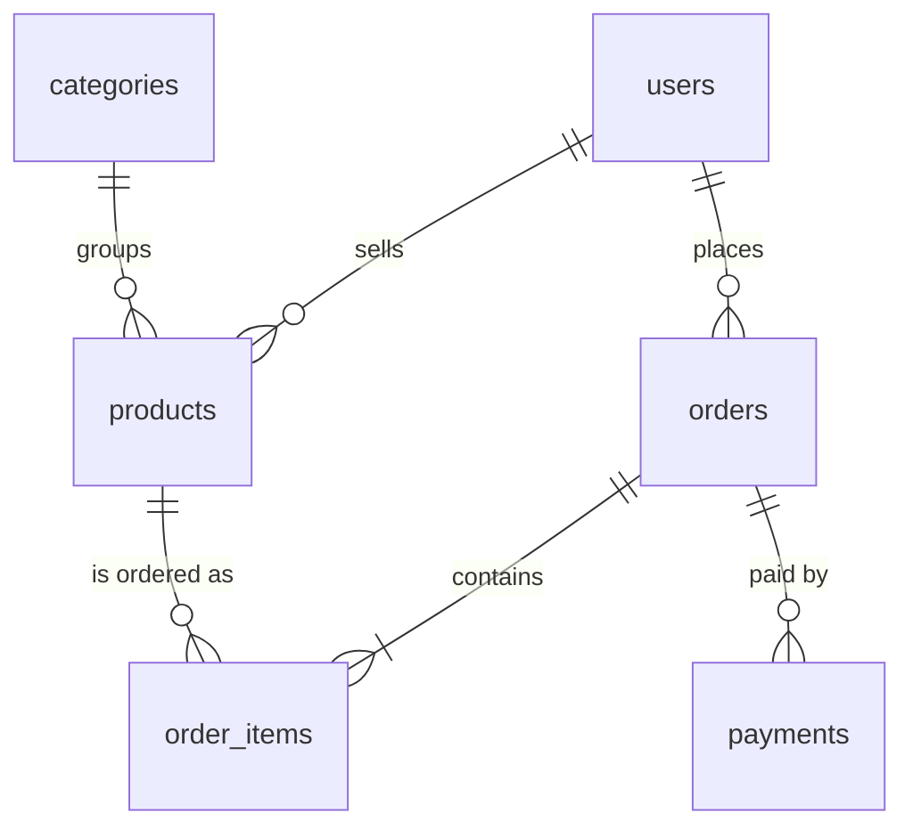

# Database schema (PostgreSQL)

| Table | Purpose | Key columns |
|---|---|---|
| users | accounts for all roles | `email` (unique), `password_hash`, `role` (customer, seller, admin), `is_active` |
| categories | product groups | `name` (unique) |
| products | items for sale | `seller_id`, `category_id`, `price`, `stock` (never below 0), `is_active` |
| orders | a customer's purchase | `customer_id`, `status`, `total` |
| order_items | products inside an order | `order_id`, `product_id`, `seller_id`, `quantity`, `unit_price` (price at time of purchase) |
| payments | simulated payment records | `order_id`, `amount`, `method` and `status` (`simulated`) |

The schema is created by `server/src/db/schema.sql` and applied with `npm run migrate`.
Passwords are stored only as bcrypt hashes.